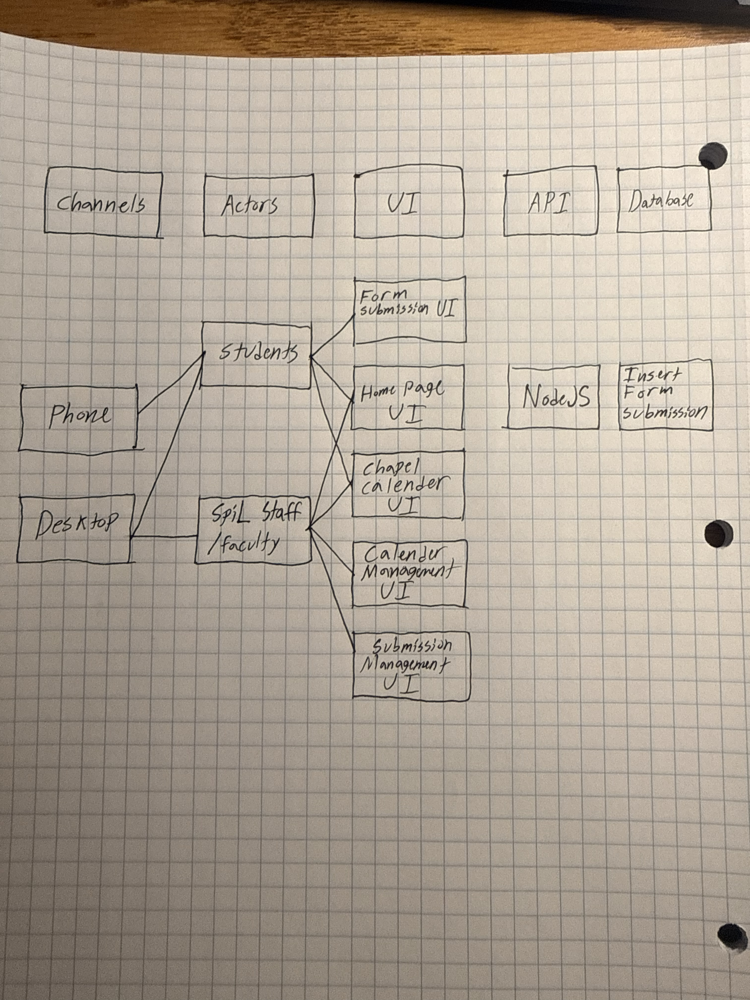
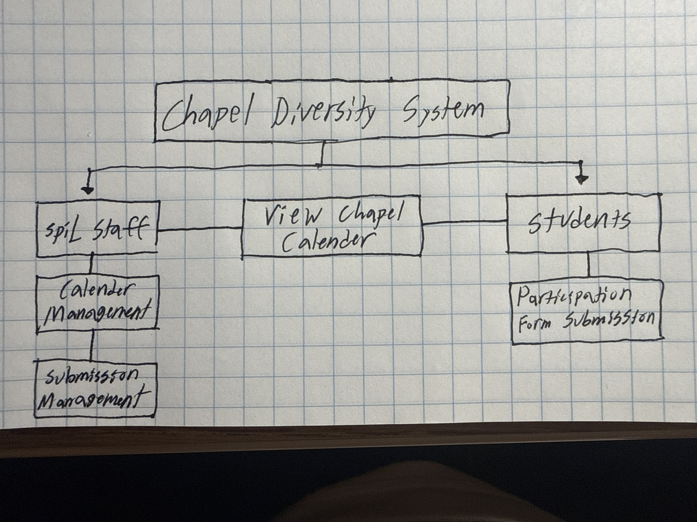
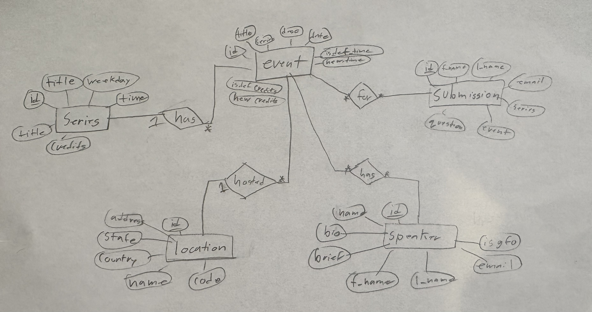
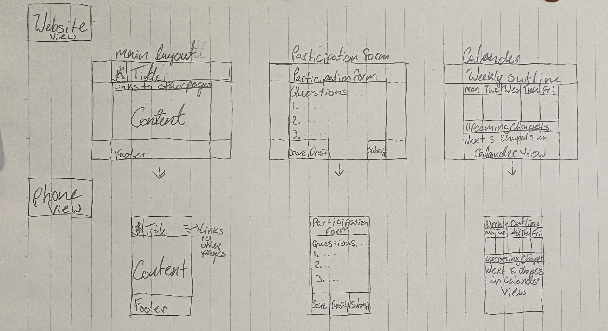

# SpiL Your Hearts

#### Oscar Chang, Levi Interian, Ady Swanson, Mia Takahashi

### Software Architecture
- Identify and describe the major software components and their functionality at a conceptual level
  - **HTML** - Provides the framework for how the website is visually structured.
  - **CSS** - Adds a visual appeal to our website
  - **JavaScript** - Adds functionality to the website and create the backend server
  - **PostgreSQL** - Our chosen database management system
- Specify the interfaces between components
  - All the front end level components will interface with an API middleware with the backend. If needed, the admin components will be connected with a websocket to the backend server if live updates are required.
- Describe in detail what data your system stores, and how. If it uses a database, give the high level database schema. If not, describe how you are storing the data and its organization.
  - **Chapel Services** -Our system will store data for the details of chapel services that include what’s listed below. At the moment, students do not have access to all of this information, namely the specific message and/or topic for each chapel. This data will be taken from an existing spreadsheet that SpiL has and transferred to. 
    1. Series
    2. Date
    3. Time
    4. Guest Speaker
    5. Specific Message/Topic for the chapel
  - Form Submissions - After students submit the form to indicate their intent to participate, their submissions will be stored in a database though a POST API request to the server. SpiL admin will be able to see this data on their end through the GET requests.
  - 
 
### Software Design
- Functional Decomposition- A module decomposition diagram for your system
-    
- ER diagram
  - 
  - The heart and soul of our project lies in the event and submissions entities. We plan to use the events table to add all the chapel events occurring. Each chapel will have a series defined by the day of the week the event takes place. Each event will also include a location (on or off campus) and a speaker (who is talking at the chapel event), if any. 
Since students are submitting a chapel participation form, all of this will be viewable on the submission table. Each submission will include the chapel that students want to participate in, represented by an event ID.
- Website layout examples
  - We designed a prototype web layout
  - 

### Coding Guideline
For each programming language that you will use in the implementation of your project, provide a link to a pre-existing coding style guideline that the members of your project will follow. Do not try to make up your own guidelines. Briefly state why you chose those guidelines and how you plan to enforce them.

[Mozilla guidelines](https://developer.mozilla.org/en-US/docs/MDN/Writing_guidelines/Code_style_guide/JavaScript)

[Javadocs](https://www.oracle.com/technical-resources/articles/java/javadoc-tool.html)

For this project, we are using two different guidelines. However, they will be used for particular elements. 

Mozilla will be for basic commenting and code writing patterns. The document provides lots of clear examples of what to do and not to do. 

Javadocs will be used for function and class descriptions. Some IDEs like VS Code use Javadocs to define the function in any language. Javadocs have also been used in our classes so our team has experience writing them. We believe Javadocs are the best way to describe what a function or class does.

We plan to enforce these rules by having a team member read the code and be sure the comments properly describe the function.

